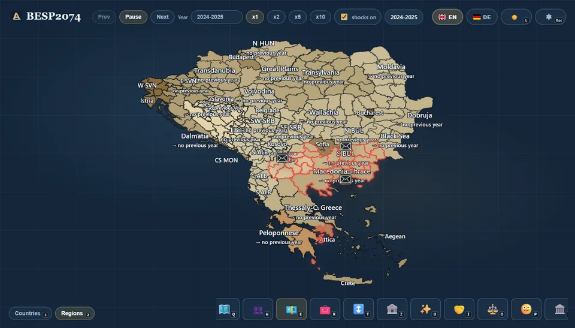
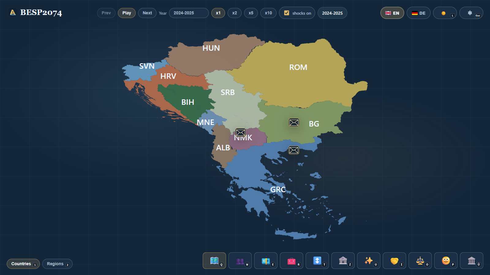

# BESP2074 - Balkan Economy Simulation Player

**Deutsch** | [English](./README_EN.md)

BESP2074 ist eine persönliche Szenariosimulation für elf Länder auf dem Balkan und in seiner Nachbarschaft bis 2074. Mitgelieferte Weltbankdaten bilden die Grundlage der nationalen Ausgangswerte. Regionale Verteilungen und Szenarioparameter beruhen auf Modellannahmen. Das Dashboard zeigt die daraus berechneten Bevölkerungs- und Wirtschaftskennzahlen.

Ein Seed macht einen Lauf bei identischen Eingaben wiederholbar. Schocks sind optionale simulierte Ereignisse. Mit dem Grenzeditor lassen sich hypothetische Zuordnungen von Regionen untersuchen. Aus solchen Szenarien lassen sich keine verlässlichen Wirtschaftsprognosen ableiten.

## Demo





## Funktionen

- Interaktive Balkan-Karte mit Länder- und Regionsansicht
- Timeline bis `2074` mit Play-, Next- und Speed-Steuerung
- Szenarien mit reproduzierbaren Seeds
- Optionale simulierte Schocks
- KPI-Modi für Bevölkerung, GDP, Arbeitslosigkeit, Inflation und weitere Werte
- Lokaler Grenzeditor für Karten-Overrides und Annexionsszenarien

## Schnellstart

```powershell
git clone https://github.com/AleksZyro/BESP2074.git
cd BESP2074
python main.py --scenario baseline --seed demo
python tools\local_run_service.py --port 8011
```

Danach öffnen:

- Dashboard: <http://127.0.0.1:8011/dashboard/index.html>
- Grenzeditor: <http://127.0.0.1:8011/dashboard/editor.html>

Eine ausführlichere Schritt-für-Schritt-Anleitung steht im [Installationsguide](./docs/INSTALLATION.md).

## Simulation starten

```powershell
python main.py --scenario baseline
python main.py --scenario baseline --disable-shocks
python main.py --scenario reform --seed reform-a
python main.py --list-scenarios
```

Die Simulation schreibt den aktuellen Run nach `output/latest.json`. Das Dashboard liest diese Datei über den lokalen Python-Service.

## Länderumfang

- Albanien
- Bosnien und Herzegowina
- Bulgarien
- Griechenland
- Kroatien
- Montenegro
- Nordmazedonien
- Rumänien
- Serbien
- Slowenien
- Ungarn

## Prüfung

```powershell
python -m pip install -r requirements-dev.txt
python tools\verify_release_ready.py
```

Die Release-Prüfung läuft in CI mit Python 3.11 und Node.js 24.

## Lizenzen

Der eigene Quellcode und die eigene Projektdokumentation stehen unter der [MIT-Lizenz](./LICENSE).

Drittanbieter-Daten und Geodaten behalten ihre eigenen Lizenzen und Nutzungsbedingungen. Weitere Hinweise stehen in den [Third-Party Notices](./THIRD_PARTY_NOTICES.md).
