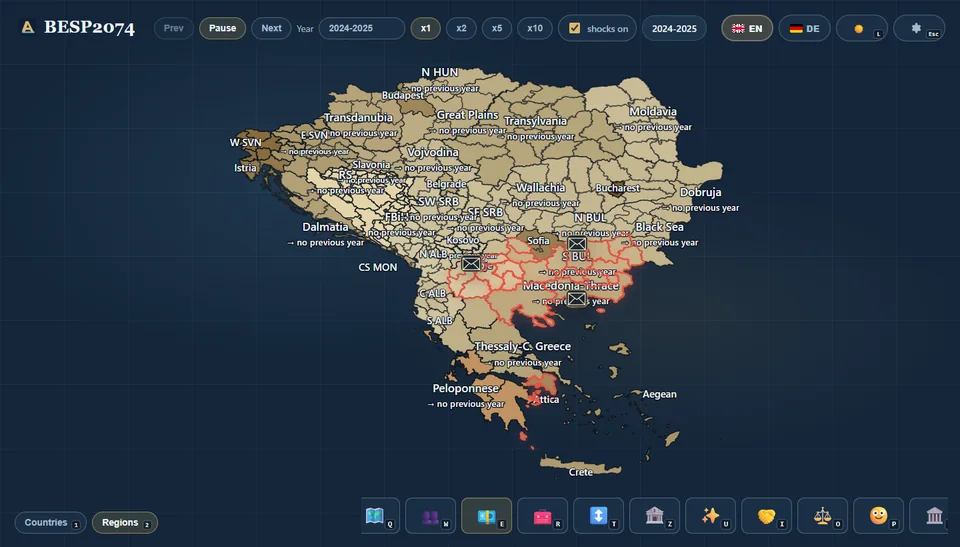
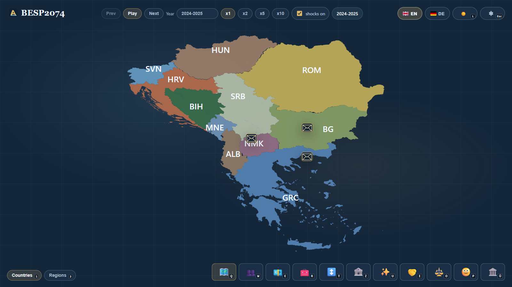

# BESP2074 - Balkan Economy Simulation Player

[Deutsch](./README.md) | **English**

BESP2074 is a personal scenario simulation for eleven Balkan and neighbouring countries through 2074. Bundled World Bank observations anchor national baselines. Regional allocations and scenario parameters are model assumptions. The dashboard displays the population and economic indicators calculated from those inputs.

A seed makes a run repeatable with the same inputs. Shocks are optional simulated events. The boundary editor lets you explore hypothetical regional assignments. These scenarios cannot support reliable economic forecasts.

## Demo





## Features

- Interactive Balkan map with country and region view
- Timeline up to `2074` with play, next, and speed controls
- Scenarios with reproducible seeds
- Optional simulated shocks
- KPI modes for population, GDP, unemployment, inflation, and more
- Local boundary editor for map overrides and annexation scenarios

## Quick Start

```powershell
git clone https://github.com/AleksZyro/BESP2074.git
cd BESP2074
python main.py --scenario baseline --seed demo
python tools\local_run_service.py --port 8011
```

Then open:

- Dashboard: <http://127.0.0.1:8011/dashboard/index.html>
- Boundary editor: <http://127.0.0.1:8011/dashboard/editor.html>

A more detailed step-by-step guide is available in the [Installation Guide](./docs/INSTALLATION_EN.md).

## Run a Simulation

```powershell
python main.py --scenario baseline
python main.py --scenario baseline --disable-shocks
python main.py --scenario reform --seed reform-a
python main.py --list-scenarios
```

The simulation writes the current run to `output/latest.json`. The dashboard reads this file through the local Python service.

## Country Scope

- Albania
- Bosnia and Herzegovina
- Bulgaria
- Croatia
- Greece
- Hungary
- Montenegro
- North Macedonia
- Romania
- Serbia
- Slovenia

## Verification

```powershell
python -m pip install -r requirements-dev.txt
python tools\verify_release_ready.py
```

The release check uses Python 3.11 and Node.js 24 in CI.

## Licences

The self-authored source code and project documentation are licensed under the [MIT Licence](./LICENSE).

Third-party data and geodata keep their own licences and terms of use. Further notes are listed in the [Third-Party Notices](./THIRD_PARTY_NOTICES.md).
